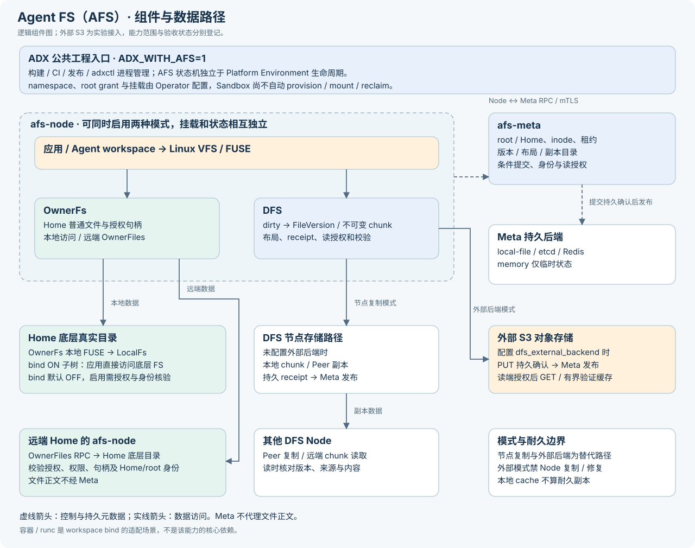
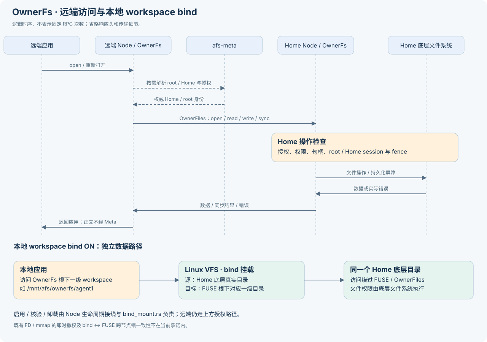
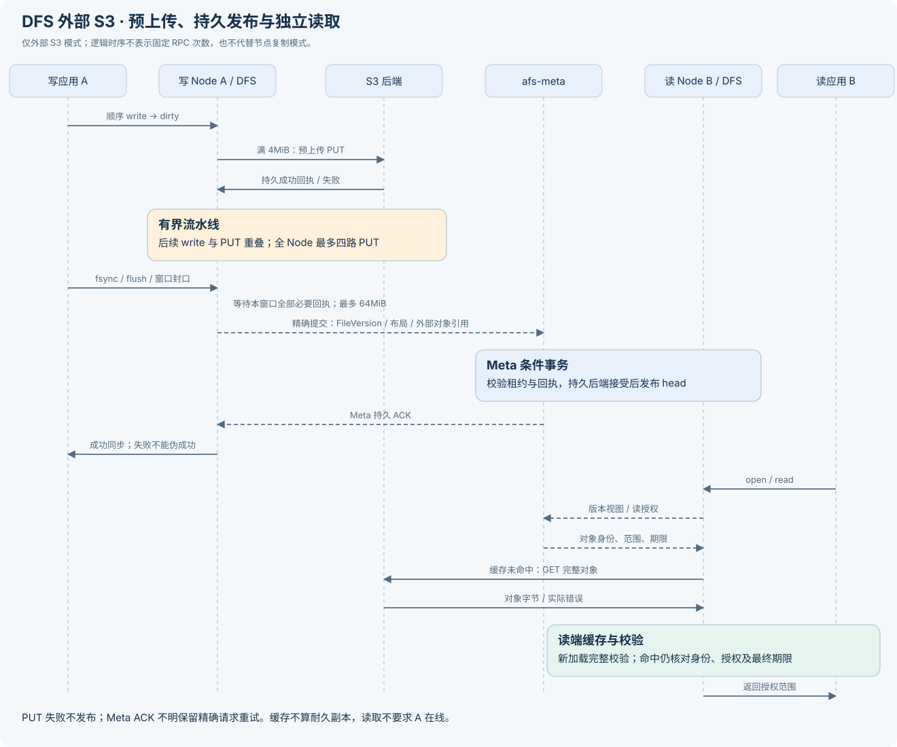

# Agent FS（AFS） 架构边界

Agent FS（AFS） 是 Agent DX 的可选文件系统子系统。它位于根级 `afs/`，
只在显式设置 `ADX_WITH_AFS=1` 时进入文件系统专用构建、测试、带组件发布包
和部署入口；默认 Agent DX 构建、包和部署不包含 `afs-meta`、`afs-node`
或 FUSE 专属系统依赖。

## 架构总览

OwnerFs 与 DFS 是平级模式。虚线箭头表示控制与持久元数据，实线表示数据访问；
`afs-meta` 不转发文件正文。DFS 节点复制与外部 S3 是替代路径，不能把图中两条
路径理解为外部模式同时保留 Node 耐久副本。图示描述当前工作树的实现边界，
不代表所有模式已完成运行或性能验收。

## 组件职责

AFS 把用户可见的文件语义和文件字节搬运分开：

| 组件 | 职责 |
| --- | --- |
| `afs-meta` | 命名空间、inode、写租约、文件版本、布局、放置、副本目录和幂等提交结果 |
| `afs-node` | FUSE 会话、OwnerFs Home 访问、DFS dirty 状态、本地 chunk 存储、复制执行、远端读、验证缓存和卸载排空 |
| `afs/common/*` | AFS 域内共享的错误、日志、指标、协议、追踪和传输 crate |
| `afs/client` | DFS 客户端 crate；不作为 Agent DX 平台内部 RPC 适配层 |

`afs/common/*` 是 AFS 域内共享层，不纳入 Agent DX 根级产品基础设施。
Agent DX 平台内部 gRPC 仍按 Environment、Runtime、Snapshot、Route 和 Node
责任拆分；AFS 不把 POSIX/Frontend 适配器接入 Platform 内部 RPC。

## Meta 与数据路径

Meta 是可恢复状态的权威，不代理稳定数据流。Meta 校验已提交状态并准备候选状态，只有持久后端接受后才发布提交结果。读请求先固定一致视图，再选择本地副本、远端副本或缓存来源，避免一次复合读混用多个 revision。

OwnerFs 面向小规模 Agent workspace。Home 节点把 workspace 保存为普通本地目录；远端节点通过受控 peer 回到 Home 访问文件。远端传输会话本身不授予文件访问权限，每次打开、读写、flush、sync 和 close 都必须校验授权、句柄、权限、root grant、session、Home session 和 fence。

DFS 把已提交数据表示为不可变 chunk。普通写入先进入 inode 的 dirty 状态；sync、同步写标志、close-time flush 或后台策略触发提交，形成新的 `FileVersion`。复制发生在文件布局之下，Meta 只在收到可验证持久 receipt 后提交新版本和副本目录。验证缓存不能自动算作持久副本。

所有启用 OwnerFs 或 DFS 权威能力的 Meta 都要求 mTLS 和
`trusted_node_certs`。CA 只证明证书链可信；Meta 还把握手得到的叶证书 DER 精确
映射到一个 Node ID，并校验 RPC 中声明的 caller／holder／owner 身份。DFS-only
部署与 OwnerFs 部署执行同一身份绑定，不能用另一张同 CA 证书冒充目标 Node。
Node 的 Meta、peer control 和 data 诊断请求复用生产 TLS 配置，诊断不建立明文旁路。
这里的 Node ID 绑定发生在服务端对调用方的校验中；客户端仍按 CA 和
`tls_server_name` 验证服务端，不承诺按目标 Node ID 对服务端证书逐一 pinning。

## DFS 原生写正文所有权

普通 FUSE 到本地 inode owner 的 NodeReplicated 写入在同句柄 FIFO 和 inode 门禁内接纳借用输入，
直接复制到最终 `ChunkBuilder` 分配。顺序写优先使用4MiB容量块；满块只切换下一块，
仍可原地覆盖，不新增冻结、下盘或发布入口。已提交内容的小覆盖使用普通小 Chunk，
大写不强制按4KiB切分。远端 owner、OwnerFs 和 S3 保留各自调度与正文账本。

原 sync/fdatasync、同步标志、累计接纳16MiB（包括覆盖）、后台写回、FUSE flush 和排空入口
消费可写 builder，将同一 Vec 分配移入共享只读 owner；planner 按最终有效来源范围形成 Chunk，
不拼接正文或将 Vec 搬成 Arc 切片。冻结不计算新的可见性保证；成功 fsync 仍等待原持久屏障和
Meta 确认。未知提交保留原 OperationId、精确请求、正文和回执，后续修改不能越过；准备失败
恢复的正文保持不可变，不能在仍有异步引用时重新变成可写。活动 dirty 读取在 inode 锁内形成
本次读取范围的只读快照，其读复制单独统计。

Node 写 buffer 池限制的是可复用空闲容量，默认128MiB、最多1024条，不限制 live 正文，
不增加全局配额等待或压力提交。共享范围按父分配实际 capacity 计费一次；最后持有者释放后
才能归池或释放。停止清空空闲列表，迟到引用结束后直接释放；池不延长 Node 生命周期。
Linux `afs-node` 默认使用官方 jemalloc：后台回收开启、dirty decay1000ms、muzzy decay0。
AFS live/idle、allocator allocated/active/resident/retained 与进程 RSS 是不同指标，
保留虚拟映射不等于保留同量物理页。S3 原有窗口、正文和 descriptor 预算独立保持，
尾块也按保留的真实 capacity 计费；本节不引入正文 RAM 内容缓存或变更读授权。

正文一次复制只指上述本地写接纳到提交正文的用户态范围；内核、远端接收、读回和完整 hash
另列。借用写会占用发生该回调的 FUSE receiver 至接纳／原同步触发结束；其它接收线程
受线程配置和有界队列限制，不能据 worker 测试声称新请求总能立即接收。
具体功能、回收及平台验证边界见[测试说明](../testing/afs.md#原生写-buffer-验证)。

## DFS 原生节点读取上下文

未配置外部后端时，新open从Meta取得fresh inode，之后同句柄复用已提交版本视图
最多5秒。截止从fresh请求前的单调时刻起算，并受Node/session原期限限制；命中和
心跳不延长该视图。到期刷新head，已有getattr、本机成功发布或truncate刷新点
使旧视图失效。close-to-open保证新打开读取最新已提交状态，不承诺已打开句柄
每次read即时感知外部修改，也不固定为永久快照；rename/unlink沿用inode及版本
保留规则，不因视图复用扩展GC或文件描述符生命周期。

版本新鲜度和授权独立。Node注册、心跳、epoch变化和停止接入同一有界读取授权，
read开始与私有结果交付前检查；source缓存仍为500ms，A端grant缓存仍最多5秒，
原grant有效期不延长。普通Meta断链只允许继续已获且未到期的上下文；新open、
head/source/授权刷新需要Meta时失败即报错。读取拒绝失效对应上下文，Node级
拒绝或epoch变化才停止共享授权，不能由单个grant到期停止所有合法句柄。

句柄表和五个按 inode 热状态表使用64分片；句柄状态独立加锁，读取快照共享
`Arc<InodeRecord>`。反向索引只定位目标 inode 的句柄；表锁不跨Meta或Peer RPC。
同句柄过期视图刷新使用单飞结果，等待者仍保留各自的授权与期限，成功刷新不撤销
已经捕获有效提交版本的读取；已知拒绝、关闭及到期仍在私有输出交付前拒绝。
这只说明单个后端/FUSE READ callback使用一个提交版本，不承诺应用一次pread被内核
拆成多个callback后仍是原子快照。source元数据和本地reader分别有界LRU，容量1024/256；
命中只更新淘汰顺序，不延长grant或TTL。淘汰释放cache引用，在途Arc仍可安全完成；
resident条目上限不是全部活跃FD、载荷或进程RSS上限。

不可变版本／布局另按完整版本ID缓存`Arc`，默认4096项，可配置容量；首次加载核对
版本、布局和长度，在使用inode时再核对归属。并发miss在锁外查询和建索引，安装时
再次检查canonical条目，不把缓存作为授权或承诺消除初次重复RPC。布局索引一次构建，
以二分定位候选；legacy未排序或重叠extent保持原序和溢出检查，不改变序列化格式。
条目上限不等于字节预算，在途Arc及其索引不因淘汰提前释放；mutable dirty布局仍走原路径。

A端完整BLAKE3通过后可复用当前不可变对象，单槽最多4MiB；填充、驻留、退役
但仍被流持有的载荷、range回退与RDMA packed共用原8MiB容量。catalog及物理身份
变化使其失效重验；保留逐range授权和返回范围的checksum，不预读下一对象。
这份正文额度与B磁盘填充、帧、扫描scratch及进程其它开销分别核算，不是Node总RSS。

### 标准根与覆盖组校验

本机读、A端Peer范围服务及B端磁盘命中使用官方Bao outboard，按32KiB覆盖组核对
同一个标准BLAKE3根，不采用独立1MiB段摘要或CRC替代根校验。outboard编码包含64B
格式／长度／标准根header及parent CV；4MiB对象最多8192B。结构与根绑定检查不等于
正文已验证，覆盖组读取仍须校验相关路径并仅向私有结果复制请求区间；实际组读取、
hash和交付复制分别计量。连续覆盖组对齐范围直接读入私有结果，借用结果交官方
range validator核对标准根，保留其32KiB scratch复制；非对齐／多范围沿用原编解码路径，
不宣称直读零复制。未请求组的静默损坏到读取
该组时检测；文件device／inode／length／mtime／ctime改变使已有证明失效。

本机持久副本的规范内容寻址ChunkId由Meta布局选定的对象提供标准根及长度锚，
再与catalog的ChunkObject核对，不新增Meta RPC，也不信任Peer自报新根。
legacy ID、旧数据、缺失／损坏sidecar或proof预算不足时保留原完整根扫描；
sidecar只帮助校验，不授予权限，不可让损坏正文通过。NodeReplicated写冻结时可
复用同预算内已计算的outboard；可选sidecar持久化在原ACK返回前执行额外文件sync、
rename，同一实际持久化批次合并目录sync。健康proof逐字节匹配后避免重写／rename，
仍保留文件与批次目录屏障；它可能增加成本。sidecar失败不改变原正文／catalog持久化屏障、
receipt或错误传播合同；后续读退回完整根扫描。S3写路径不生成这份原生写proof，
原外部窗口、载荷／descriptor预算和有序发布合同独立保持。

### B端可丢弃磁盘缓存与Peer交接

B的`dfs_peer_cache`默认OFF，只存可丢弃磁盘副本，不写入LocalChunkStore副本目录，
不产生DurableReplica或持久ACK。文件v2布局为固定4096B header、正文、proof trailer
（最多8192B）；body offset固定，不把proof写进正文。旧v1缓存条目可在专属缓存目录
退休并重建，不迁移或删除持久副本。缓存仍按namespace及完整ChunkObject隔离，
命中与交付前校验授权、Node/session及期限；close-to-open仍由新open的fresh视图保证。

Meta的ChunkSources可附带当前授权视图中的合法区间；提示缺失或超过128段时保守
沿用原范围读取。只有当前整个对象获授权、填充与私有输出满足原单批预算时，B才
请求当前整对象并设置`include_blake3_outboard`；这不是预取下一对象。A仅对明确请求
且完整对象的响应附outboard，partial仍只返回精确授权范围及原range checksum，
不制造B端完整对象证明，也不扩大grant。partial由A核对可信根覆盖组，B保留原range checksum，
不宣称B独立完成根证明。旧Peer不支持新字段时保留完整根安全回退；
未知格式、超限、截断或标准根／对象身份绑定错误明确拒绝。

满足原窗口及multi-thread runtime条件时，gRPC用既有runtime单producer接收当前对象，
全链仅两个256KiB独占载荷块，wire帧至多64KiB、交接队列至多一项。Header中的proof先
转为有账typed元数据并退役解码Bytes，再随现有control交给consumer。首正文前固定校验
模式：预算支持的完整peer tree由consumer增量计算唯一正文标准根；producer保留顺序、
长度、deadline、Completion与真实EOF验证。缺proof、预算不足或旧Peer保留producer完整
根安全路径，不能中途失败再改校验模式。consumer仍写私有pending、提取范围并构建outboard
后归还块；缓存写失败不跳过完整核根。实际hash分别计量，不能把累计耗时直接相加。
旧诊断`SegmentBlake3`表示consumer的outboard工作，不是独立段摘要。

原4MiB填充额度覆盖原载荷块、控制余量、受限解码及HTTP/2积压，私有输出另按原读预算
计费；窗口过大、current-thread或其它transport保留原缓冲回退，不增加正文RAM缓存。
缓存创建／配额／写盘失败只禁用可选sink，同次RPC继续完整验证和提取，不重复回源。
consumer收到Completion仍不能产生完成凭证；实际EOF和producer成功join后，内部回执
必须匹配Completion长度／摘要及私有sink／输出绑定；consumer模式还须用实际计算根
同时匹配Meta锚定的整对象根和Completion，fallback保留producer完整根与consumer核验。之后引擎最终授权通过才可rename为Ready及公开输出。late Status、期限、校验、
授权失败不放行；取消仍关闭接收端并真实join，不能提前释放块或proof租约。

A store、原生写pool与B cache在同一Node共用原1MiB proof ledger，不各自新增额度。
其内计入outboard实际capacity、Arc／包装、构建与编码／解码临时工作，以及缓存证明
索引（当前64位构建中4096个指针占32KiB）。共享引用直到最后owner释放才退账；
预算不足时不生成或不保存优化证明，保留完整根安全路径。该预算不等于整个Node RSS，
codec／TLS／网络编码拷贝仍属于原transport envelope，不冒称已由proof ledger覆盖。
ready文件的4096B header、正文、trailer与staging实际分配计入磁盘容量；目录、marker等
管理开销另列。近似LRU只淘汰专属可丢弃缓存，不增加持久副本数。

原生gRPC的64KiB正文帧仍以Bytes共享已验证对象的合法范围；A附带proof也以Bytes
共享原proof owner，B仅在同ledger准入后复制小proof元数据。载荷、proof及各自租约
不能因缓存淘汰、producer退出或取消提前退账；最后真实持有者释放后才释放额度。
授权与帧生产继续在同一blocking任务，拒绝在返回stream前传播；原4帧队列、8 read slots、
单RPC总截止和排空合同保持。Bytes共享不等于整个Prost／TLS／网络栈零复制。

以上描述当前实现及受影响回归边界；具体通过范围须绑定Linux输入和证据，
不代表WI-6正式验收或性能目标已经通过。

## FUSE 接收与页缓存

Node通过公共挂载配置控制接收线程、descriptor clone和callback worker；队列满时等待
容量，普通完成分别唤醒worker或容量等待者，不在接收线程内执行尚未准入的owned任务。
借用写仍在原回调生命周期内接纳，并保留同fh顺序和排空；不能把借用输入放进后台队列。

后端动态确认安全的native只读句柄允许同fh连续READ形成并发批次，排队的write、resize、
flush、fsync及release仍为排他屏障，后续READ不能越过。OwnerFs、S3和可写句柄维持原
排他调度。能力检查本身有元数据查表和授权成本；不将后端局部两次查表说成全链仅两锁。
官方fuser默认协商buffered异步READ；本次没有额外启用ASYNC_DIO，不能将并发单测
外推为O_DIRECT单流或整体E2E提速。

DFS普通I/O沿用cached write-through，不启用writeback。默认entry/attr TTL为0；每次新open
在线观察Meta，原生只读且没有dirty/provider/外部后端时，用完整提交版本ID和已核对长度
决定`FOPEN_KEEP_CACHE`。同inode身份完全相同才保留，缺失、变化、超限或不安全路径均不保留；
成功数据修改撤销该inode的复用资格。身份表最多65536项、版本字符串合计1MiB，另计表结构，
不占用磁盘cache的proof额度，也不保存正文。

固定64个本地inode分片读写锁覆盖READ实际回复完成和OPEN fresh观察至回复完成，避免
旧READ在新OPEN清页后重新填入旧正文。它不是跨节点读许可或撤销协议。内核已收到的页面
没有再次进入用户态授权检查的机会，不能宣传为可立即撤回的载荷；新open和用户态交付
仍遵循权限与授权合同。正TTL是明确的宽松路径模式，不满足严格close-to-open。

OwnerFs使用同一接收／worker配置，其Home缓存、TTL、direct-I/O及mmap协商保持独立。
DFS的版本复用与read-ahead设置不覆盖OwnerFs策略。read-ahead是向内核请求的上限，
实际协商值须记录；它不是下一对象预取。每操作读预算不等于Node全局私有输出配额，
提高worker数可能增加同时存活的输出Vec，需与帧、cache、allocator和RSS分别核算。

## OwnerFs 远端与 bind 数据路径

远端 FUSE 经 OwnerFiles 到 Home 访问普通文件，Home 逐操作核验授权和身份。
本地 workspace bind 的源是同一个 Home 底层真实目录，目标是 OwnerFs FUSE
根下对应的一级目录；该子树的访问由 Linux VFS 直接进入底层文件系统。
挂载授权与身份核验属于生命周期，不表示每次 bind 文件操作都回到 Node。
其他未被 bind 覆盖的目录仍走 FUSE；容器不是此能力的前提。

图为逻辑时序，root/Home 查询按需发生，不承诺每次读写的固定 RPC 数。
bind 与远端访问共享底层文件，新打开的可见性及权限仍需按支持范围验证；
图示不承诺已有 FD/mmap 即时撤权或跨节点锁一致性。

## DFS 外部对象持久化边界

图示为当前外部 S3 实验路径：PUT 成功与 Meta 持久 ACK 是两个独立屏障。
顺序 write 可与预上传重叠，独立读者只见已提交 head；fsync 强制收口，
成功返回仍要求所有必要对象已获成功回执且 Meta 已持久确认。缓存命中
可省略 GET，但不能省略适用的版本、授权、对象身份和期限检查。
此预上传与 64MiB 发布窗口不作用于 OwnerFs。

可选外部后端配置把新文件系统固定为单副本策略：本地暂存不是耐久副本，
不运行 Node 复制／修复。Node 用官方 S3 客户端执行普通 PUT，成功后返回
绑定 store/generation/key、完整长度和摘要的有类型凭据。Meta 在原版本提交
事务中发布外部对象引用和 inode head；旧 Node 复制凭据与外部凭据不能混用。

S3 默认保留载荷签名；显式 `dfs_external_backend.unsigned_payload=true` 只将 SDK
载荷签名策略改为 unsigned，SigV4 请求认证仍在。AFS 业务完整 BLAKE3、对象长度、
回执身份、错误传播和发布持久屏障不变；该选项不是关闭内容校验，也不自动适配
或部署第三方后端。

S3 桥接复用一个自有线程、runtime 和客户端，容量1的入口队列满时等待；
worker 最多持有32个命令。所有命令共享四个上传许可，单个 PUT 完成即可
调度下一块，不再等待固定四块全部完成。顺序写每满4MiB即预上传，每 inode
以64MiB为一次发布单元；冻结窗口的上传与下一窗口的有界生产可重叠，
按原预算余量接纳，没有额度即回压。最终发布仍通过原 Meta 条件事务串行执行。
普通 write 可先报告已接纳；fsync、可写 flush 和 drain 必须覆盖此前已接纳的
全部相关窗口。Meta 请求在途或 ACK 未知时暂停新修改，保留精确请求重放。
旧窗口 ACK 只推进其序号，保留 active 内容与属性。成功 PUT 回执经身份核验后，
正文可独立退休；最后 transport／retry／read pin 释放才退实际正文账，提交描述
跨 Meta 未知 ACK 保留。Uploaded 仍占逻辑窗口，不作为空洞或扩大窗口额度。
满 active 窗口在前窗仍 Preparing 时推进原提交链，冻结当前窗后才继续接纳；
逻辑窗口的回压不依赖物理正文是否已经释放。
普通 rename 保持独立 Meta 事务，不新增隐式全文件 fsync。窗口首 PUT 前
固定 operation_id，成功回执仅归属本窗口；部分失败保留窗口和成功部分，
Meta 未知确认保留精确请求并阻挡后续 mutation。fsync／可写 flush／同步写
仍等待全部必需回执及 Meta 持久确认。覆盖和截断先安全排空已有窗口，再走
同步修改路径。写侧通过字段私有的 `StagedChunk` 传递已封口身份，HTTP PUT
使用不可变 payload 视图，避免封口后再做一次全量 hash 或 `to_vec`；dirty、
stage、transport、retry 和最终 owner 交接共享有类型预算租约。首次封口仍要
完整计算 chunk 身份，原有预算、fsync、错误传播和退出排空语义不降低；这里
不宣称全链路零拷贝。独立只读客户端只见已提交 head；外部模式同挂载／owner
代理的 dirty read 复用 inode-wide DataSync 屏障，完成入口前已接纳序号的有序
发布后，再走原授权及完整校验读取。失败直接报错，不回退旧版本；读可触发尾部
提前发布，open／getattr 不触发。无 pending 写时不增加 Meta 写事务，非外部
DFS 保留原 dirty overlay。未同步崩溃只恢复最后已提交版本，不新增 WAL 承诺。服务端已接受的
不可变对象不能取消撤销或盲删，正常退出关闭入口、排空并 join worker。

B 在每次 open 在线观察最新已发布 head，建立一致的版本／布局／长度视图。
外部读使用 `AuthorizeExternalVersionRead` 从当前 Meta 状态验证版本归属、
reader session／epoch、对象身份和合法范围，不以旧 MAC 作为续期凭据。
每块完整校验，在最终返回前再次检查期限及已知失效。该路径不伪装
Peer 接收者，也不依赖原 writer session。内容 cache 默认 OFF；可选 Node
本地有界异步 cache，以 store/generation/chunk 身份隔离。完整校验后的内容
先进入有界 pending，再由单后台线程写入临时文件并 rename；正常退出排空。
可选填充先确认任务和pending分配能接纳，再进行磁盘容量淘汰。淘汰只采样
Ready候选中的两个条目，比较1秒单调访问时间桶并选择较旧桶；同桶保留首个
随机候选，不按精确访问顺序打破平局。命中刷新桶，首次Ready和恢复索引按当前
进程时钟初始化，不持久化时间桶。无候选则放弃可选填充，只释放本次所需空间，
不引入95%批量低水位。候选扫描受原条目上限限制，不复制整份候选索引。
删除仍在缓存锁内完成，失败恢复索引资格且不扣减实体容量；磁盘对象删除不能
退还仍由caller pin持有的内存。此策略改善的请求量和性能必须通过实际负载验证。
读仍先获 Meta 授权，损坏缓存丢弃后回源。S3／磁盘读取只通过字段私有、构造时
校验完整长度和 BLAKE3 的只读缓冲区交给读引擎；引擎核对完整 chunk 身份后
复制授权范围，保留最终期限检查。开启cache时，Node共享一个最多4MiB的已验证
对象槽，按完整chunk身份复用相邻请求；授权复用与内容缓存分别限额。驻留、
Ready尚未验证的分配、pending／worker以及槽位替换后仍被读者持有的已接纳分配，共用原pending额度，
按Vec容量去重计费，最后引用释放后才可复用额度。预算不足不保留新槽位，回退
原读取路径。新磁盘加载仍核对私有文件并完整校验；RAM命中不探测磁盘副本之后
的损坏／权限变化，检测延后至下一次磁盘加载。不是每个handle各保留一个对象。
S3 GET 与 Ready 磁盘缓存重载共享每个 store 的私有两线程 BLAKE3 池，使用固定
官方 BLAKE3 的 rayon 接口计算同一个完整摘要；入口最多允许一个对象校验。
Ready重载在单个对象的原分配内分为至多四个1MiB段，使用同一个Hasher按顺序
更新完整摘要；每轮在私有池hash当前段，调用者同时读取下一段的不重叠切片，
scope结束前等待已接纳任务。没有通道或中间正文复制，全部摘要、长度和EOF
验证后才交接；空对象直接完成EOF和空摘要检查，短尾按实际长度处理。
这不预取下一对象、不并行执行同fh回调，不增加对象队列、驻留或载荷额度。
Ready切换对象时，仅在旧resident载荷没有其他reader／fill持有者且容量足够时，
消费其唯一所有权并复用原Vec；容量而非新对象长度继续计费，原Verified身份同时退出。
被pin、容量不合适或预算不足时使用原准入／错误路径，不增加常驻池。
新对象仍必须完整读取、检查EOF和完整BLAKE3，失败不得恢复旧Verified身份。
committed external只读的私有最终结果通过相同最终授权／epoch／失效检查后，
以owned Vec交给FUSE回复，省去staged到另一输出Vec的复制；DFS外部批量读取的借用接口保留
全部范围成功后才修改调用方输出的语义。dirty／remote／其他后端沿用原read路径。
Ready原始分配先预留原pending预算，验证后转移给同一不可变分配；在途任务
退出前不退账，旧reader pin继续计费。预算不足传播容量错误，不删除Ready文件
或绕道回源；启动恢复也沿相同预算，缓存锁不跨读取／校验。调用者仍等待整个
对象验证完成。校验异常关闭入口并保留失败；正常退出先排空已有工作，再显式
关闭并 join 校验线程，失败传回 Node 退出路径。此机制的功能与性能结论须绑定
实际 Linux 候选，不能由线程数或 hash span 缩短推导 E2E 改善。
S3读取观测复用进程Registry，标签仅包含固定phase／source／result，区分排队、
SDK响应头合计、正文首片／累计／最大等流、复制、最终EOF、回复及缓存准入。
GET校验计时包含gate和hash；Ready校验计时包含gate、加载和hash，两者不能
都解释为纯CPU哈希。成功校验字节按来源单列，失败按固定stage／result计数；
失败计数不代表取得全部失败阶段耗时。达到对象长度后仍接纳合法空分片并等待
真正EOF，非空超长、截断和流错误仍拒绝。慢GET阈值50ms，摘要每store每60秒
最多16条，累计慢请求指标不受日志限流截断；摘要无URL、凭据或完整对象路径。
这些边界不揭示SDK内部建连／重试原因，不修改连接池、重试或读取协议。
外部只读句柄复用已观察的不可变版本／layout；重新 open 必须在线获取最新
head，open／getattr 或本挂载修改观察到新版本时一致地刷新关联句柄。旧 FD 不承诺
立即看到远端发布，也不是终身快照；rename／unlink 后仍绑定原 inode。
每次回调保留打开模式、对象范围、Node/session、期限及已知失效检查。

对象授权上下文最长5秒，同时受 grant 和 reader session 截止限制。Node 按 RPC
发出时的单调时刻计算截止，缓存命中和心跳均不能续期。最多128个上下文、
授权元数据预留最多1MiB；被在途读者持有的引用释放前仍计费，包含保守估算的
键、映射开销和有界投影，载荷预算不增。超出保留预算则本次在线核验、不保留
可复用条目。已知对象／版本拒绝使对应条目失效，保守终止与拒绝并发的在途
批次；不会据此终止整个 Node。已知 session／epoch 失效和正常 shutdown 则关闭
本地读准入，并与最终输出串行化；错误不走重新签发或旧授权回退。

Meta 纯传输断链时，已打开视图的未到期合法范围可读本地 cache 或已授权 S3
对象；新 open、新对象和到期续期仍须 Meta。未知 Meta 重启只允许沿用到原截止，
不新增撤销广播／boot watch；持久状态恢复后从当前身份重新准入，不要求旧 MAC
继续有效。状态丢失不能用本地缓存补造目录或持久成功。Node 重启丢弃授权缓存。
原逐批 MAC 核验接口保留其原拒绝语义；dirty 写、稀疏回退和 P2P 保持原路径，
不借此改变写 fencing 或 OwnerFs 授权。输出仍在完整验证和最终检查后一次发布。

缓存额度不充当进程 RSS 或文件系统总配额。小块写允许缓存与 PUT 重叠，但只有 PUT 成功才返回持久凭据。
对象存储部署与服务端持久性属于外部依赖，Meta 状态持久化
仍由 AFS 配置的 Meta 后端承担。详见[配置](../deployment/afs.md#dfs-外部-s3-连接)。

## OwnerFs workspace bind mount

OwnerFs workspace bind mount 是当前实际试用场景的优先能力，默认 OFF。开启后，它把 Home 上 workspace 的底层真实目录 bind 到 OwnerFs FUSE 根目录下对应的一级目录，例如 `/mnt/afs/ownerfs/agent1`。把 FUSE 目录自身 bind 到别处不满足此设计。

核心实现只负责挂载、身份核验和卸载；runc、容器启动、执行、停止和探针属于适配层。ON 场景仍需保留授权、Home/root/epoch 核验、数据新鲜度、close-to-open、权限、错误传播、正常卸载和受管引用排空。当前不承诺已有 native FD、mmap、描述符转移或二级 clone 的即时撤权。

## 后置能力

当前不承诺以下能力：完整 POSIX、复杂可靠性、多 Meta、高可用、etcd/Redis
后端验收、大规模长时间运行、RDMA 性能专项、跨节点 `fcntl/flock`、阻塞锁
等待取消、bind/native 与远端 FUSE 锁域协同。bind 本机 ext4 锁和单挂载
内核回退不能宣传为分布式锁。

支持范围、验证边界和性能目标见 [Agent FS（AFS） 演进计划](../development/afs-plan.md)。

写流水线的 normal 128MiB 租约分别归属原 partial dirty 分配、pending Vec 容量
及 sealed Arc；封块后 dirty 与 HTTP/retry 共享 sealed 租约，旧 partial read pin
仍持自己的租约。32MiB publisher 仅预留 Vec→Arc 的瞬时转换峰值，不能长期
借给下一窗口。额度在分配前取得、最后一个持有者释放后归还；descriptor
维持独立1MiB／32项上限，缓存 pending36MiB不混用。
