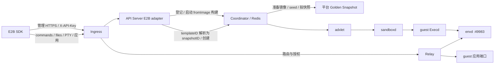

# E2B 兼容（实验版）

ADX 在原生 Environment 生命周期上提供 E2B SDK 兼容入口。控制面适配管理协议，数据面经 Ingress/Relay 到 guest envd；Coordinator 负责调度，owner adxlet 负责运行计时和生命周期，Execd 管理固定上游 envd。本文说明部署配置、接口合同、能力边界和验证方法。

## 支持范围

| 能力 | 当前合同 |
| --- | --- |
| 创建 | `POST /sandboxes`、`POST /v2/sandboxes` 共用处理；解析平台模板的 Ready build 或本租户 E2B snapshot，等待配置服务就绪 |
| 查询与列表 | `GET /sandboxes/{id}` 返回状态、时间及凭据；`GET /v2/sandboxes` 支持 state/metadata/limit/nextToken，返回原始数组和 `X-Next-Token`；旧根路径 GET 列表未接入 |
| 模板 alias | 裸 alias 查询本租户已注册名称，返回实际 templateID；仅 default selector 解析 latest-success，custom tag 明确拒绝。平台只保存 current 与 latest-success |
| 删除与续期 | `DELETE /sandboxes/{id}` 复用原生删除；`POST /sandboxes/{id}/timeout` 设置从当前时刻计算的期限，0 表示立即到期 |
| Connect | `POST /v2/sandboxes/{id}/connect` 对运行态续期，对暂停态恢复；timeout 默认 300 秒，可取 1～86400 秒 |
| Pause/Snapshot | `POST /sandboxes/{id}/pause`、`POST /sandboxes/{id}/snapshots` 支持内存模式；memory 省略或 true，false 明确拒绝；实际能力取决于 backend/checkpoint storage |
| Snapshot 查询/删除 | `GET /snapshots` 查询 Regular；`DELETE /templates/{id}` 先解析平台模板并逻辑删除绑定，有引用时拒绝；普通运行态 snapshot ID 保留原生删除路径 |
| 数据面 | commands、files、PTY 和应用端口经共享网关转发；网关鉴权模式增加 SDK 签名文件 URL，见下文配置与限制 |
| Key 管理 | `POST/GET /api-keys`、`DELETE /api-keys/{uuid}` 复用原生凭据服务，具体认证差异见下文 |
| 出站网络 | 创建和 `PUT /sandboxes/{id}/network` 支持 IPv4/CIDR 策略；真实效果依赖可执行 ACL 的后端 |

E2B 错误使用原始 JSON `{code, message, error_code?}`，不使用 ADX data envelope。不支持能力返回明确错误；例如检查点后端不支持时为 400 / `capability_not_supported`，不按错误文本推断。

模板准备仅接入 fromImage；RUN/COPY/fromTemplate/startCmd/readyCmd、私有镜像凭据、完整日志和缓存优化暂不支持，启动前明确返回 capability_not_supported。Code Interpreter、完整 Desktop/computer-use、IAM/卷/MCP、自动恢复、磁盘暂停及高级网络未接入。实验版不声明完整 E2B API/生态兼容。

## 构建与配置

1. Buildkite 的两种架构 Execd 组件默认在 Linux 构建器内拉取 `third_party/e2b/source.json` 固定的 infra revision，校验源码摘要后编译 envd；失败即中止构建。可用 `ADX_ENVD_SOURCE` 指定同一固定版本的干净 checkout；ARM 封装会将宿主目录只读挂入容器并转换路径。独立 `build/release/build.sh` 仍需设置此变量才编译 envd。rootfs 包含固定 envd、bash/动态库和默认 user；发布包保存 envd LICENSE、manifest 和摘要。
2. sandboxd 使用 [固定上游 revision](../../third_party/sandboxd/source.json)。当前 AMD64 后端二进制包要求 glibc ≥ 2.34；Firecracker 的递归 virtiofs 挂载保护依赖 `mount_setattr`（Linux 5.12+ 或具有相应回移的内核），仅存在 `/dev/kvm` 不足以证明宿主可用。[后端构建器](../../build/e2e/build_backend.py) 校验来源和工件摘要；Firecracker host/initrd 与 backend 使用配套的同源工件，详见 [kit 说明](../../build/e2e/firecracker/README.md)。不承诺不匹配的工件和快照之间兼容。
3. 使用 fromImage 在本租户登记名称并准备 Golden Snapshot；已有快照可直接按 snapshotId 创建。E2B 配置不保存第二份模板目录，也不依赖 Agent Template、Activator 或 ADX_AGENT_CONFIG。准备流程复用 Coordinator 与现有 worker，需要支持真实 Snapshot 的运行后端。
4. API Server 与 worker 配置相同可信 RuntimeProfile，worker 标签匹配 requiredNodeLabels。标签不安装 profile；当前每个 worker deployment 只有一个 profile。

API Server `config` 示例使用支持内存 Snapshot 的 Firecracker 后端（替换域名、路径、实际 Relay 来源和工件摘要）：

```json
{
  "runtime_profile": {
    "rootfs": {"runtime_class": "firecracker", "type": "local", "path": "/opt/adx/e2b-v1/runtime/adx-runtime-rootfs.img", "readonly": false},
    "bootstrap": {"type": "erofs", "root": "/opt/adx/e2b-v1/runtime/adx-runtime-rootfs.img", "target": "/__adx", "entrypoint": ["/__adx/usr/local/bin/adx-execd"]},
    "env": {"ADX_ENVD_PATH": "/__adx/usr/local/bin/envd", "ADX_ENVD_SHA256": "REPLACE_WITH_BUILT_ENVD_SHA256", "ADX_ENVD_DEFAULT_USER": "user", "ADX_ENVD_DEFAULT_WORKDIR": "/home/user"}
  },
  "e2b": {
    "domain": "sandbox.example.com",
    "envdVersion": "0.9.0",
    "envdIngressSources": ["10.42.0.1"],
    "requiredNodeLabels": {"adx.runtime.profile": "e2b-v1"}
  }
}
```

OCI 镜像提供用户 rootfs，可信 bootstrap 只读挂到 `/__adx`。fromImage 直接复用原生后端的镜像解析、拉取、缓存和 Env 继承，不在 Coordinator 另建 registry 客户端；需要固定镜像内容时传入 `@sha256:...` 引用，可变 tag 的重新解析沿用原生 ADX 行为。不执行 ENTRYPOINT/CMD，也不自动继承 OCI USER/WORKDIR。默认用户和目录来自可信 envd profile（user、/home/user）；缺用户时 Execd 使用镜像 useradd 创建。镜像须提供 bash、envd 动态依赖以及已有用户或 useradd。快照中的资源、执行配置及服务配置随产物固定。envVars 允许覆盖普通变量，不能覆盖 `ADX_`/`EXECD_` 控制键。Firecracker 使用对应 runtime class；网关鉴权模式由 Execd 追加 `--isnotfc`，跳过 envd 的 MMDS 集成，保留 VM 隔离和 cgroup。

容器部署时，将 sandboxd 状态目录放在支持 OverlayFS upper/work 的独立状态卷上，例如 ext4；容器镜像自身的 overlay 层不能作为该路径的 upperdir。状态卷可挂载到短路径，再配置 `rootDir`、`storeDir` 等目录，为 runsc 动态生成的 Unix socket 路径预留长度。

envd 容器 worker 使用包内 [OCI 基线](../../build/config/examples/e2b-runc-oci-spec.json)：在固定默认基线上增加 `CAP_SETUID`、`CAP_SETGID`、`CAP_CHOWN`、`CAP_DAC_OVERRIDE`、`CAP_FOWNER`，供用户切换、文件归属和 root chmod user 上传文件；`oomScoreAdj=0` 允许 envd 将命令分数调整为 100，不增加 `CAP_SYS_RESOURCE`。原生 worker 保留原基线；当前 E2B 网关鉴权入口仅接受 runsc、firecracker 和 firecracker-pvm，不支持 runc。

```toml
[plugin.runtime.basic_spec]
runc = "/opt/adx/current/etc/examples/e2b-runc-oci-spec.json"
# runsc worker 使用相同基线：
# runsc = "/opt/adx/current/etc/examples/e2b-runc-oci-spec.json"
```

核查实际 OCI bundle 采用该配置；sandboxd 旧加载器读取失败会回退默认值。修改基线后，在无活动沙箱的隔离 worker 重启 sandboxd、创建新沙箱，旧容器不会自动取得权限。sticky `/tmp` 的 user 文件覆盖可能受 Linux protected_regular 限制，优先使用 `/home/user` 或非 sticky 子目录。

Ingress 设置 `ADX_DATA_PLANE_INGRESS_E2B_ENABLED=true`、`ADX_DATA_PLANE_INGRESS_PORT_HOST_DOMAIN=sandbox.example.com`，配置正式 HTTPS 证书、源地址 ACL、API Server 和 Relay 目标 CIDR；独立/内嵌模式共用入口实现。升级配套使用同版 Coordinator、adxlet、API Server、Ingress 和对应工件，所有相关节点升级完成后再开启 E2B；旧节点不识别新增的 envd/run_policy 字段，不能承担该配置的执行。

从 master `54efe5a` 存量前向升级的删除回执合同为：保留原有 600 秒有效期，旧回执仅允许 Environment ID、generation 和完整结果摘要相同、且未提交新增 cleanup artifacts 的删除重放；空 artifact scope 不改变旧结果的序列化字节。升级验收须覆盖旧格式 Redis/节点 journal、双版本进程切换、存量实例访问和生命周期，以及 AKernel 集成，不能以数据 fixture 回归代替完整升级验收。此前未发布 PR 的中间 schema 不提供迁移；新增 E2B 能力不得在旧节点混部期间启用。

上述存量前向升级先更新 Coordinator，再更新 API Server 和 Ingress；旧 owner 在此阶段继续处理既有原生实例，新增 E2B 能力仍须等待相关节点全部升级后开启。控制面切换期间的请求和长连接可用性取决于副本及切换部署，不能由 guest 持续运行推导为入口零中断。

节点或后端的计划升级先停止新分配，对需要保留的 Running 实例执行 Pause，确认权威 Paused 状态、恢复点可用、待补交结果已确认及活动 Runtime 已停止；其余实例迁移或删除，完成排空后再退出和升级。adxlet 收到 SIGTERM 会执行 planned unregister，使旧 owner 会话失效，不适用 crash 后未过期会话的进程接管条件。新节点注册并完成对账后，通过 Connect 恢复原 Paused 身份，必要时沿原生恢复调度重新分配。恢复节点须提供与原 Spec 一致的受信任 profile/bootstrap，并保留仍被引用的检查点和旧工件；停止控制面使 unregister 失败不属于计划滚动升级流程。

回退 master 也需要单独验证：新 Snapshot 写入的 kind/created_at_unix_ms 字段会被旧版的严格反序列化拒绝。升级前验证备份与恢复方案；出现问题时按已验证的恢复流程或前向修复处理，不直接回退二进制并假定持久化数据兼容。

## Python SDK 用法

使用原版 `e2b==2.52.0`，在进程环境设置 ADX 的 `E2B_API_URL`、`E2B_SANDBOX_URL` 和本租户 API Key。SDK 不要求 Key 必须使用 `e2b_` 前缀；使用 ADX 正式发放的凭据。`template_id` 为本租户已 Ready 的模板 ID，其他服务的模板 ID 不会自动导入 ADX。

```python
from e2b import Sandbox, SandboxQuery, SandboxState

sandbox = Sandbox.create(template_id)
try:
    running = Sandbox.list(limit=20, query=SandboxQuery(state=[SandboxState.RUNNING]))
    print(running.next_items())
    print(sandbox.commands.run("echo hello world").stdout, end="")
    sandbox.beta_pause()  # SDK 2.52.0 中为 pause() 的兼容别名。
finally:
    sandbox.kill()
```

两个 URL 可使用同一入口。固定 `E2B_SANDBOX_URL` 时 SDK 通过 `E2b-Sandbox-Id`、`E2b-Sandbox-Port` 和访问凭据路由 envd。若入口为 `https://sandbox.example.com/agentenv`，部署层反向代理必须对管理及数据面请求统一剥离 `/agentenv` 后转发到 ADX 根路径，同时保留路由头、WebSocket 和流式响应；直连根路径不需要改写。ADX 不增加 E2B 专用前缀分派。

SDK 2.52.0 生成独立文件签名 URL 时使用根路径 `/files`，会丢弃固定入口中的路径前缀，也不会在 URL 中加入沙箱路由头。因此上述固定入口适用于普通命令、文件和 PTY 调用；直接使用 SDK 生成的独立签名 URL，需要标准的逐沙箱 Host/DNS 地址与对应 TLS 配置。不能仅凭固定入口的普通文件读写通过，就认定独立签名 URL 可用。

## 镜像准备与 Golden Snapshot

实验模板入口采用下述固定协议；功能互通不代表完整 E2B 兼容，恢复后的时钟和网络行为仍需按部署后端单独验收。

```text
SDK 注册名称 → 平台登记 preparation → SDK 提交 fromImage
  → Coordinator 复用原生创建 → sandboxd 拉镜像并继承 Env → seed 配置服务 Ready
  → 原生 Snapshot(kind=golden) → 删除 seed → Ready
Sandbox.create(templateID[:tag]) → Ready snapshotId → 原生从快照创建
```

`POST /v3/templates` 返回稳定名称绑定的 templateID 和新的 buildID；同名仅保存 current preparation 与 latest-success 指针，current 尚未终态或清理未完成时返回 busy，串行准备；`POST /v2/templates/{templateID}/builds/{buildID}` 仅启动 waiting 构建，重复启动返回参数错误。状态使用 `GET /templates/{templateID}/builds/{buildID}/status` 查询。SDK 可使用 `Template().from_image("python:3.11")` 与 `Template.build(..., name="base")`；镜像须符合后端架构和依赖要求。仅接入公开 OCI registry 的匿名拉取。

只接受省略 tags、空 tags 或 default；custom tag 明确返回 capability_not_supported。名称/templateID 的创建解析只选择 latest-success；新准备失败不遮住该结果。不保存任意 build 历史：仅 current 和 latest-success 可查询，更早的 buildID 返回 404。`GET /v2/templates` 明确不支持，不提供家族目录分页或兼容占位；Golden 使用原生 Snapshot 列表。

平台 Snapshot 增加 `kind=regular/golden` 和 `createdAt`。原生 `GET /api/environment/v1/snapshots?kind=golden` 列出本租户 Ready Golden，通过同一个 snapshotId 创建入口使用；Regular 克隆不变。公共目录解绑可由调用方显式要求无使用者；E2B 删除入口启用此限制。模板逻辑删除不自动删除独立 Golden，也不保证取消正在执行的构建；快照实体继续使用原生删除和 GC。

公共 RPC 返回真实准备阶段、资源、ID 和快照可用性；E2B waiting/building/ready/error 只在适配层转换。E2B 冒号后缀仅接受 default，buildID 用于 current/latest-success 状态查询，固定产物可直接使用 snapshotID。

准备状态、输入和确定的 seed/operation/snapshot 身份持久化在平台。Coordinator 接管已登记任务并清理失败 seed；结果未知先查询既有操作，不换 ID 重拍。恢复扫描跳过正在执行的 build，并使用原生恢复同样的有界并发；不新增任务引擎。终态且清理完成后释放完整执行规格，Ready 摘要从原生 Snapshot 读取；删除目录的全部待办完成后按 epoch/CAS 回收墓碑，不删除独立 Golden。组件重启可重试已知阶段，不承诺任意构建断点精确恢复。缺少镜像 useradd 或 bash/动态依赖时明确失败，不提供完整上游 sudo 环境。

## 请求路径与鉴权



管理请求实时验证 `X-API-Key`，不复用 API Server 成功认证缓存。创建/恢复须等待 Execd、envd `/init`、实际版本和鉴权探测完成才发布路由；版本取 `/init` 的 `X-Envd-Version`，不是 `/health`。E2B 运行期持续检查 envd，退出/探测失败触发 Failed、路由撤销和清理。

仅启用 E2B 时解析数据面 `<port>-<sandboxID>.<domain>` 或 `E2b-Sandbox-Id`/`E2b-Sandbox-Port`，两者同时提供须一致。Host 同时满足原生 `<environmentID>-<port>` 格式时默认选原生目标，仍执行该目标已发布的策略；原生失败不会回退到 E2B。数字后缀 sandbox ID 导致格式重叠时，选择 E2B 目标须同时提供与 E2B Host 一致的两个转发头。SDK 使用 `X-Access-Token`，网关鉴权模式校验后剥离；私有应用使用 `E2b-Traffic-Access-Token`；`/init`、Execd 50090 及控制端口不对 E2B 数据面开放。每次创建/clone 生成独立 envd 和 traffic 凭据。

策略跟随目标路由：启用 E2B 策略的沙箱通过 E2B 地址、原生地址和统一端口路径执行同一授权及凭据清理，拒绝无法检查内部 HTTP 路径的通用 CONNECT/L4 隧道。原生 `/direct/{id}/...` 仍要求原生认证及同租户；普通原生路由保持公开端口匿名、私有端口使用原生平台 Token 的合同。Gateway 只校验凭据、服务就绪和当前执行身份；暂停、删除或迁移通过既有路由撤销结束转发。运行期限由 owner 节点计时，路由不携带运行 deadline/控制版本，Gateway 不按绝对时间准入或为流设置 expiry guard。

## 网关鉴权

启用 E2B 兼容入口即使用 Gateway 鉴权，无独立 `gatewayEnvdAuth` 开关。旧配置中的该字段会因未知字段校验在启动时拒绝，升级时必须移除；不提供 legacy alias。原生 envd 服务配置仍可显式使用 guest-token 模式。该入口须使用 ACL 后端和当前鉴权模式产生的快照。配置片段如下，地址须替换为实际观测且验证过的同节点 Relay 来源，通常为 sandbox bridge IP：

```json
{
  "e2b": {
    "envdIngressSources": ["10.42.0.1"]
  }
}
```

上述片段合并进前面的 e2b 配置；runtime profile 选择 runsc 或 Firecracker，并在 sandboxd 开启 `enable_network_acl`。runc 不支持该 ACL，不能启用无 token 模式。API Server 不接受空来源、通配来源、CIDR、未指定或组播地址；不要将 guest 可借 SNAT 取得的出口 IP 当作可信 Relay 来源。必须在真实部署验证 Relay 实际源 IP、同节点及跨节点 guest 流量，配置语法通过不构成隔离验收。

构造与最终校验共用 `adx_core::envd` 的端口、优先级和规则匹配小函数；原生 create、clone、update、start 仍分别执行必要校验。平台为 guest envd TCP 49983 添加优先级 `UINT32_MAX-2` 的入站拒绝，再以 `UINT32_MAX-1` 允许精确可信来源。其余应用端口保留原策略；不能将 49983 声明为公开端口或 tunnel HTTP 端口。动态 E2B 出站更新保留入站保护；原生网络策略替换若缺失或覆盖保护规则，节点在调用 backend 前拒绝。节点按公共 protected_ingress 执行校验；具体 envd 配置由服务边界校验。普通 L4/CONNECT 转发拒绝 private_service_ports，仅经协议策略授权的 HTTP 路径可访问。backend 在 ACL 不可用时拒绝 Start；检查点与恢复复用其网络生命周期。启用前须同步升级 API Server、Coordinator、Ingress/Relay、adxlet 和 Execd，不能用旧网关验证新模式的端口保护。

```text
SDK token / 文件签名 → TLS Ingress：路由、执行身份、凭据及控制路径检查
                    → 剥离 SDK token 和已验证的文件签名
                    → Relay → envd（不设置 token）
其他 guest / 外部直连 → backend 入站 ACL → 拒绝 envd 端口
同 guest 程序        → envd → 允许（接受的权限降级）
```

SDK token 和 traffic token 继续逐沙箱独立生成、持久化及返回。Execd 通过受控 `ADX_ENVD_GATEWAY_AUTH=true` 识别新模式，省略 `/init.accessToken`，保留 freeze、unfreeze、恢复 init 与联合就绪。`EnvironmentSpec.envd.gateway_auth` 和可信来源随实例/快照保存；旧快照携带的 envd token 不能假设已消失，API 明确拒绝旧模式快照克隆（409），Execd 拒绝恢复时切换鉴权模式。

签名仅授权 `/files` 的 GET 下载或 POST 上传。网关从仅允许 Ingress 身份订阅的 Coordinator RouteService 获取 SDK 原 token 作为签名材料，校验与路由 token 哈希一致；Debug 隐藏原文。使用上游 v1 的 SHA-256 拼接和标准无 padding Base64，绑定文件 path、read/write、username 和可选到期秒数；重复参数、过期、篡改、其他沙箱 key 和操作不匹配均拒绝。携带错误的 SDK header 不会回退到签名。无到期参数沿 SDK 合同允许，但仍受签名自身到期校验和沙箱路由撤销约束；它不是一次性 URL。旧模式不新增签名 URL 能力。

接受的降级仅说明平台不依靠 envd token 限制同 guest 的进程：它们可能调用 root 文件/命令能力以及 init/freeze 等控制接口。guest 所有者发布的应用若主动转发本地 envd，相当于其应用对外委托这项能力；平台无法一边允许该内部调用，一边阻止所有自建代理。跨沙箱直连不属于这一豁免，必须由入站隔离证明。代码/组件测试不能代替部署隔离和真实 checkpoint/restore/clone 验收。

## Metadata、期限与检查点

E2B metadata 直接映射到原生 `EnvironmentSpec.scheduling.labels`，不另设 metadata 模型、持久字段或创建/发布副本。它对原生调度选择可见，随 Snapshot 执行规格继承；创建请求的 metadata 覆盖继承 labels 的同名项。详情和列表从 labels 投影 metadata，多键筛选转为原生 LabelSelector 的 match_labels。创建、claim、local-first 和请求重放沿用原生 spec/operation/winner 规则，不保留 metadata 专属冲突规则，也不写入 guest env。

E2B 入口保留最多 128 项、键 256 bytes、值 4096 bytes、总计 64KiB 的响应大小约束；内部执行继续使用原生 labels 校验。列表复用 `EnvironmentDirectory::page`，tenant、E2B 范围、state 和 labels 在分页前过滤，目录未同步时明确失败。每页 1～100、响应约 1MiB，游标绑定 tenant/范围/state/selector。时间字段按页通过公共 `BatchGetEnvironmentControl` 批量查询，列表专用 summary 直接投影所需字段；不逐条查询 control，不构造含 token 的详情后再删除凭据。实时目录分页不保证历史快照一致性。

可选 `EnvironmentSpec.run_policy` 保存默认运行时长与 Pause/Delete 动作；当前 E2B 入口填写它，原生公共 HTTP 暂不开放，未配置的原生实例无额外期限。当前 owner adxlet 在首次 Running 或恢复接管时建立单调时钟 timer。进程 crash 后，仅在旧会话未过期且未退役、相同节点 ID 与 RPC/Relay 地址通过原生身份校验并成功接管现存 Runtime 时，才按 Spec 默认时长重建 timer；先前的动态续期不跨进程保存。SIGTERM 计划退役不适用该接管条件，节点计划升级须先 Pause 或排空。频繁更新不持久化绝对 deadline。Connect 只延长至 `max(当前截止, now + timeout)`；setTimeout 替换为 `now + timeout`，0 表示立即到期，均由 owner 接受后返回。owner 串行处理续期和到期，执行前复核 runtime、assignment generation 与 timer 更新序号；到期进入既有 Pause/Delete，失败保留重试。Coordinator 不保存动态 control、续期 CAS 或到期扫描/claim。

显式 Pause 停止当前 timer；Resume 开始新周期。E2B Connect 对暂停态先复用原生 EnsureRunning 恢复（包括可接管的离线 owner），再为本轮运行设置请求时长；运行态 Connect 仍只延长期限。Paused Connect 的请求时长随原生恢复意图保留，并传到最终 owner，在首次建立该运行期 timer 前消费；原 owner 不可用、替代调度及后台重试沿用同一恢复意图，RPC 等待预算不作为运行时长。合并到既有恢复意图的请求不改写其初始时长，恢复后的 Connect 续期只延长、不缩短，避免重试重置 timer；Spec 默认时长不变。暂停态独立更新的 nextDuration 只在下一次运行消费一次，不跨节点进程重启保存；Snapshot 临时暂停/源恢复保留原 deadline，capture 耗时计入本轮运行。普通 Running 重报不续期。`startedAt` 复用原生 CreationSummary 的首次成功 Running 时间，Pause/Resume 后保持；运行态 `endAt` 是 owner 剩余单调时长映射到当前墙钟的估计值。Paused `endAt` 来自 RestorePoint 的真实保留期限，Forever 映射为 `9999-12-31T23:59:59Z`。

模板 snapshotId、实际规格、profile 和 pause policy 在创建时固定，alias 改动只影响后续创建；Pause/Connect/clone 不回查当前 alias，恢复所需旧 profile/工件不可用则失败。暂停保留期复用原生策略，缺省 90000 秒，可配置 Forever/Shared，与原装 E2B 的无限保留存在差异。`autoPause:true` 的 autoPauseMemory 缺省为内存模式，显式 false 拒绝。secure 省略/null/true 沿用 envd 鉴权；false 为 400 / `capability_not_supported`，错类型/未知字段为 400。

Execd 使用上游 envd 原有 `/freeze`、`/unfreeze`、`/init`，不修改 envd。`ADX_ENVD_FREEZE_ON_CHECKPOINT` 默认 true，由可信 profile 注入，可设 false。freeze 总限时 2 秒，保持 best-effort：204/no-op/部分冻结/超时不算完整冻结证明，但记录发送尝试以便回滚。重复同一 operation 复用结果，新 operation 重新准备；调用方断连不取消已接受的协作。`--no-cgroups` 不证明用户进程冻结。

未开始 capture 的回滚，或已确认源继续运行的 checkpoint，须 `/unfreeze` 成功才报告 Running，失败为 Failed；已停止的源不额外解冻。未知 handoff 结果不授权重捕获或盲目解冻。恢复走 `/init`，保留 envd 进程/命令表，失败不发布路由。网关模式中的 envd 无 token，克隆只换发网关凭据，Execd 恢复 `/init` 不配置 accessToken；旧模式快照不能作为网关模式的克隆源，恢复也拒绝改变已有 auth mode。

host/initrd/快照须与固定 sandboxd revision 和工件摘要配套。宿主不支持 Direct I/O 对齐时，可在空 worker 验证后使用固定 sandboxd 的 `writable_io_engine="Sync"`。

## 后端已知限制

恢复校时和 TAP 恢复隔离属于 sandboxd Firecracker 后端的公共限制，当前 ADX 不提供额外修复。原生 ADX 与 E2B 使用同一后端时均可能受影响：

| 问题 | 影响与验收边界 |
| --- | --- |
| 恢复后 guest 时钟偏差 | 恢复后 guest 时钟可能落后于宿主，影响用户程序的绝对时间、定时器或凭据判断。部署时检查 Pause/Connect 与 clone 的时间行为 |
| clone 恢复时的网络干扰 | clone 恢复窗口中，源 MAC 可能被学习到 clone TAP，导致源流量转错、连接失败或 Relay 504。该限制由 sandboxd 的恢复网络流程处理，不能据此判定所有 504 的原因 |
| 跨运行时复用 TAP | 当前 backend 的 runsc 接管路径未显式复位 Firecracker 可设置的 offload 状态。单 backend 混合这两类运行时的连接行为需单独验收；不能把单运行时结果外推为混布通过。`interface_cache_size=0` 会关闭正常 ACL 所依赖的接口管理，不能作为禁用复用的替代 |

这些问题不改变 E2B 接口适配范围，但会影响实际 Pause/Connect、Snapshot/clone 的正确性或可用性。保留时钟、源沙箱与 clone 独立访问的验收检查，按实际结果记录；不通过提高 Relay 超时、跳过检查或在 ADX 增加绕行逻辑宣称通过。

## API Key 与网络

Key 管理采用 ADX 管理员认证：`X-Admin-Token` 或 `Authorization: Bearer <ADX administrator key>` 二选一，`X-Team-ID` 须等于管理员 tenant，普通 X-API-Key 不授予管理权限。这与原装 AuthProvider JWT 是明确差异，不支持跨团队管理或重命名（PATCH 为 501）。

POST 只接收 `{ "name": "ci-key" }`，name 非空、最多 256 个非控制字符；同名允许，创建不幂等。201 一次性返回 `key`，列表只返回 UUID id、RFC3339 createdAt 和真实 mask，createdBy/lastUsed 为 null，成功响应 no-store。新密钥统一复用 `adx_` 加 64 个小写 hex，SDK 将其作为不透明凭据；内部不再区分 E2B KeyFormat。历史 `e2b_` 密钥仍可认证、查询和撤销，不替换前缀转换旧密钥。DELETE 为 204，缺失/已撤销/其它 tenant 为 404；tenant/UUID 校验与撤销原子执行。

撤销在下一次 E2B 管理请求实时生效，不删除沙箱，不广播断开已有连接，不撤销独立 envd/traffic token；原生入口及 Ingress 认证缓存仍按其原有合同工作。

真实 ACL 要求专用 worker 开启 `[plugin.network] enable_network_acl = true`。固定 sandboxd 拒绝 runc 非空网络策略和动态更新，runsc systrap 可执行 ACL 且不需要 KVM；Firecracker 另需 KVM。核查 iptables/ip6tables/ipset、bridge netfilter、conntrack 及权限，backend、bridge/TAP、ACL hooks 和报文处于同一可管理网络命名空间。hostNetwork 不是唯一部署方式；bpfnat 另需 Linux 5.17+/TC eBPF/可写 bpffs，完整条件见固定 sandboxd 的 `doc/network-acl.md`。

创建与更新共用 IPv4/CIDR 转换：创建时未提供覆盖字段才继承快照出站策略；显式 `allow_internet_access:true` 或空 `allowOut`/`denyOut` 会应用允许/清空覆盖，同时保留受保护 ingress。allow 优先级 200、deny 100，默认允许；`allow_internet_access:false` 默认拒绝，`network:{}` 保留模板 allowPublicTraffic。域名、通配符、IPv6、egressProxy/rules/maskRequestHost/httpsPorts 明确拒绝。更新是出站配置替换，`{}` 清除旧出站规则并恢复默认允许，保留原生入站、DNS 及 stateful/stateless mode，Both 只保留 Ingress 投影；不接受动态 allowPublicTraffic。仅 Running 可更新，沿同一权威 revision 调用节点，竞争为 409，执行失败不返回 204。

链路为 Ingress→API Server→EnvironmentService→adxlet→sandboxd，不调用 envd。保留平台控制流量例外，已有连接行为继承 backend；HTTP 204 或单元测试不是实际阻断报文的证明。

## Harbor 预置模板接入

Harbor 0.25.0 使用锁定的 E2B SDK 2.25.0。将任务依赖预装入 OCI 镜像，通过 fromImage 准备 Golden Snapshot，并登记任务实际使用的精确 alias。使用管理员签发的普通 ADX key、官方 SDK 地址与 CA 配置，运行 `--env e2b --no-force-build`。未知 alias 不回退 base。

仅支持 fromImage 准备，非空构建步骤明确拒绝。保持任务原有网络要求，PUBLIC 使用默认网络策略；NO_NETWORK/IPv4 依赖支持 ACL 的后端，域名/通配符仍不支持。验证时保留 Harbor/SDK 的正常协议、secure 参数、路由和 alias，使用正式发钥接口；通过真实 provider/Oracle 检查任务执行结果和文件权限。

## 验证入口

在独立测试部署运行，通过 HTTPS 与已安装 SDK 验证业务行为，完成后核查测试实例、backend 和制品释放。基础驱动固定 SDK 2.52.0、envd 0.9.0；Harbor 验收单独锁定 SDK 2.25.0，不能用新版替代。不要开 debug 直连本地 envd；无通配 DNS 时显式配置 sandbox_url。

最小 SDK 调用（使用部署 CA 的标准 SSL_CERT_FILE 配置）：

```python
import os
from e2b import Sandbox

sandbox = Sandbox.create("base", api_key=os.environ["E2B_API_KEY"],
                         api_url="https://adx.example.com", sandbox_url="https://adx.example.com",
                         timeout=60)
try:
    assert sandbox.commands.run("printf ready").stdout == "ready"
finally:
    sandbox.kill()
```

| 入口 | 检查内容 |
| --- | --- |
| [smoke.py](../../build/e2b/smoke.py) | 管理、命令/文件/PTY、端口、metadata、鉴权、期限/续期、envd 故障撤路由，以及 user 上传→root chmod→直接执行 |
| [checkpoint.py](../../build/e2b/checkpoint.py) | Pause→Connect 内存/进程连续性、时钟、snapshot 源继续运行、双 clone 独立运行/文件与凭据隔离、断连 snapshot、测试资源清理；可分阶段执行 |
| 组件测试 | Gateway 真实 envd、Execd init、Coordinator Redis/RPC 等；不代表真实 VM/集群验收 |

```sh
ADX_TEST_ENVD_BIN=/absolute/path/to/envd ADX_TEST_E2B_PYTHON=/absolute/path/to/python \
cargo test -p data-plane-gateway --test e2b_envd -- --ignored --nocapture --test-threads=1
ADX_TEST_ENVD_BIN=/absolute/path/to/envd \
cargo test -p adx-execd real_envd_initialization -- --ignored
ADX_TEST_REDIS_SERVER=/absolute/path/to/redis-server \
cargo test -p adx-coordinator --test storage e2b_ -- --ignored
```

Pod 内直接运行 envd 组件测试，若继承 oom_score_adj 高于 100，测试容器需 `CAP_SYS_RESOURCE`；这不是给生产 guest 增加该权限。传入测试 CA 和两个独立租户 key 文件，凭据/token 不写入结果。

## 删除后的制品责任

已登记共享 checkpoint/capture 继续由原生 registry、Snapshot 引用、execution holds 和 GC 管理，不重复加入 cleanup outbox。本地或确实未登记制品在 Deleted 退役时原子保存最小 pending payload，逐项幂等清理并收到完整 ACK 后 HDEL；部分清理、ACK 丢失或组件重启保留待办，本地节点永久丢失也不因 TTL 自动确认成功。

删除重试沿用 600 秒 DeletedReceipt，增加规范化 cleanup payload 摘要；完成后不保留独立永久 cleanup/artifact fence。journal 遇 NotFound/Conflict 时须读取 fresh assignment，确认旧归属已撤销才丢弃旧条目，不把丢弃当作原提交成功。正常 Snapshot 发布在同一 CAS 比较源记录，防止 source 已退役后的迟到发布；制品 UUID 不复用，scope 继续阻止 alias 改指 bucket/prefix 后删错物理目标。
